# RoyalTeam BIS List — Handleiding voor raiders

Met de BIS List geef je door welke items je graag wilt hebben (je **soft reserves**). Je lootmeester gebruikt die lijst om loot eerlijk te verdelen. Deze handleiding legt stap voor stap uit hoe je de lijst gebruikt, en helpt je als er iets niet werkt.

Je vindt de app op **https://lootlijst.royal-team.nl**. Je kunt hem ook op je telefoon gebruiken. Deze handleiding staat ook **in de app zelf**: klik bovenin op **Handleiding**. Op sommige schermen (Mijn Loot, het Gearing plan) staat een **?**-knop die direct naar het juiste stuk springt.

> Oude link gebruikt (`crusaders.royal-team.nl` of `crusaders-bis-list.onrender.com`)? Dan zie je het scherm "Wij zijn verhuisd!". Ga naar de nieuwe link en sla die op als bladwijzer.

---

## Inhoud

1. [Snelstart in 5 stappen](#snelstart-in-5-stappen)
2. [Inloggen](#1-inloggen)
3. [Je character instellen](#2-je-character-instellen)
4. [Het loot-scherm: wat zie je?](#3-het-loot-scherm-wat-zie-je)
5. [Een item reserveren](#4-een-item-reserveren)
6. [Een reservering aanpassen of annuleren](#5-een-reservering-aanpassen-of-annuleren)
7. [Items op je chase-lijst zetten](#6-items-op-je-chase-lijst-zetten)
8. [Zien wie er nog meer op een item zit](#7-zien-wie-er-nog-meer-op-een-item-zit)
9. [Je character of team wijzigen](#8-je-character-of-team-wijzigen)
10. [Wheel of Fortune (rolls bekijken)](#9-wheel-of-fortune-rolls-bekijken)
11. [Veelgestelde vragen en troubleshooting](#veelgestelde-vragen-en-troubleshooting)

---

## Snelstart in 5 stappen

1. Ga naar de site en klik op **Inloggen met Google**.
2. Kies je character (via Battle.net, of vul hem zelf in) en je **main spec** en **team**.
3. Je komt op **Mijn Loot**. Zoek het item dat je wilt.
4. Klik op **Reserveer**, kies vanaf welke tier je het item wilt (Champion, Hero of Myth) en bevestig.
5. Klaar. Het item staat nu bovenaan in je **Soft reserves**.

Zie je een item dat je graag wilt hebben maar niet kunt reserveren (zoals armor)? Klik dan op **Chase met bonusrol** of **Chase voor bossdrop**. Dat is geen reservering, maar je officers zien zo wat jij nog zoekt. Zie [hoofdstuk 6](#6-items-op-je-chase-lijst-zetten).

---

## 1. Inloggen

Je logt in met je **Google-account**. Er is geen apart wachtwoord voor deze site.

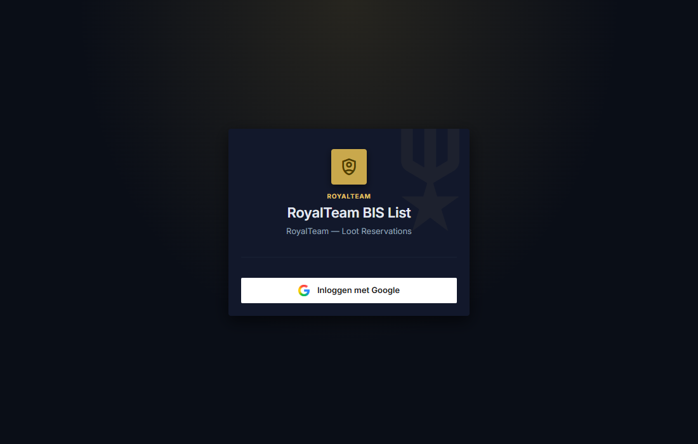

- Klik op **Inloggen met Google** en kies je account.
- Je blijft normaal gesproken lang ingelogd. Je hoeft dus niet elke keer opnieuw in te loggen.
- Gebruik **altijd hetzelfde Google-account**. Met een ander account maak je een nieuw, leeg profiel aan en zie je je reserveringen niet terug.
- Uitloggen kan rechtsboven met **Uitloggen**. Op een telefoon open je daarvoor het menu (de drie streepjes).

---

## 2. Je character instellen

De eerste keer dat je inlogt, kom je automatisch bij **Welkom bij RoyalTeam BiS List**. Je kunt het op twee manieren doen.

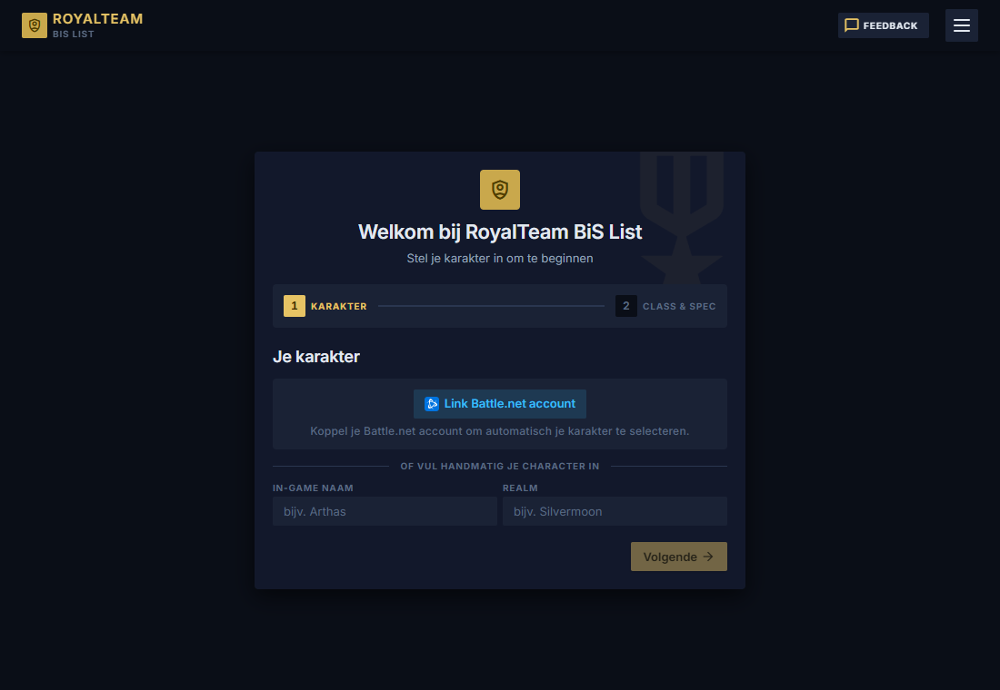

### Optie A: via Battle.net (aanbevolen)

1. Klik op **Link Battle.net account**.
2. Log in bij Blizzard en geef toestemming.
3. Je ziet een lijst met je characters (level 10 en hoger). Klik op het character waarmee je raidt.
4. Kies je **main spec**.
5. Kies je **team** (Crusaders of Templars).
6. Klik op **Aan de slag!**

Zo staan je naam, realm en class meteen goed.

### Optie B: zelf invullen

1. Klik op **Handmatig invullen**.
2. Vul je **in-game naam** en **realm** in en klik op **Volgende**.
3. Kies je **class**, **spec** en **team**.
4. Klik op **Aan de slag!**

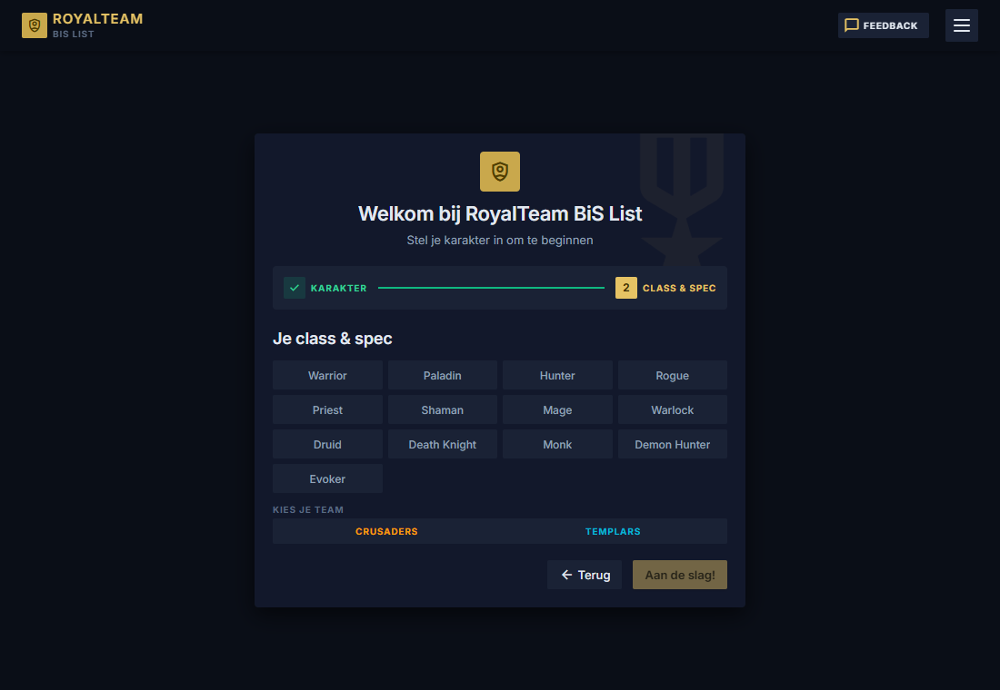

Bij handmatig invullen controleert de app je character niet bij Battle.net. Let dus goed op typfouten.

### Kies je spec en team met zorg

- Je **spec** bepaalt welke items je kunt zien en reserveren. Items die niet bij jouw class en spec passen, zijn verborgen.
- Je **team** bepaalt welke regels voor jou gelden, zoals het aantal reserveringen dat je mag doen. Weet je niet zeker in welk team je zit? Vraag het je raidleader.

---

## 3. Het loot-scherm: wat zie je?

Na het inloggen kom je op **Mijn Loot**. Het scherm heeft drie delen.

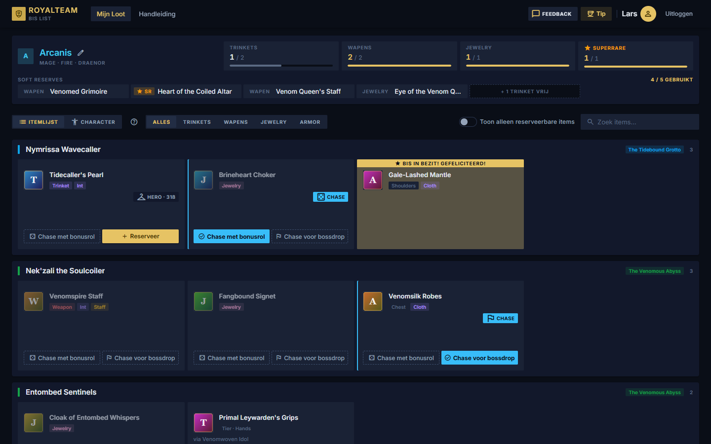

### Bovenaan: jouw overzicht

- **Je character**, met naam, class, spec en realm. Het potlood-icoontje ernaast gebruik je om je character te wijzigen.
- **Limiet-tegels** (Trinkets, Wapens, Jewelry, Armor, Superrare). Elke tegel laat zien hoeveel reserveringen je hebt gebruikt, bijvoorbeeld **1 / 2**. Het maximum verschilt per team en wordt door de officers ingesteld. Een categorie die niet wordt getoond, kun je dit seizoen niet reserveren. Die items staan wél in de lijst en kun je op je [chase-lijst](#6-items-op-je-chase-lijst-zetten) zetten.
- **Soft reserves**: een lijst met de items die je hebt gereserveerd. Lege plekken zie je als `+ 1 Trinket vrij`. Klik op een gereserveerd item om het aan te passen.

### Het midden: filters

- **Tabs**: Alles, Trinkets, Wapens, Jewelry, Armor. Een tab verschijnt alleen als er items voor jouw class en spec in staan.
- **Toon alleen reserveerbare items**: een schakelaar naast de zoekbalk. Standaard staat hij **uit** en zie je dus alle items die jouw class en spec kunnen gebruiken, ook armor. Zet je hem **aan**, dan verdwijnen de items die je dit seizoen niet kunt reserveren (die je alleen op je chase-lijst kunt zetten).
- **Zoekbalk**: typ een deel van de itemnaam.
- Je gekozen tab en de stand van de schakelaar blijven onthouden tijdens je bezoek.

### Daaronder: de bosses

Alle bosses van de huidige raid staan onder elkaar, met per boss de items die jouw class en spec kunnen gebruiken. Elk item heeft een kaartje met vaste plekken: elk onderdeel staat op elk kaartje op dezelfde plek, ook als het er (nog) niet is. Zo vind je alles snel terug en staan de kaartjes netjes onder elkaar. Van boven naar beneden: het item met zijn badges, een regel met status (*via* een tier-token, wat je draagt, chase), de hoofdactie (reserveren, aanpassen of BiS), een regel voor een mogelijke upgrade en onderaan twee knoppen: links **Chase met bonusrol**, rechts **Reserveer**, **Pas aan** of **Chase voor bossdrop**. Een kaartje bevat:

| Onderdeel | Betekenis |
| --- | --- |
| Icoon en naam | Het item. Hebben twee items één samengevoegd icoon, dan tellen ze als **één** reservering. Ga met je muis over het **icoon** (of tik erop op je telefoon) voor de uitleg uit het spel: waaraan je het herkent, welke stats het geeft, wat het item doet (Use/Equip) en bij een tier-item de set-bonussen. De waarden van de stats staan er niet bij, want die hangen af van je upgrade track. Dit werkt ook in het character-overzicht, het Gearing plan en de admin-weergave. |
| Categoriebadge | Het soort item: Trinket, Weapon, Jewelry of Off-Hand. Bij armor staat hier de **plek** (Head, Shoulders, Chest, Wrists, Waist, Legs, Feet, Hands), met daarnaast het armortype (Cloth, Leather, Mail of Plate). |
| **Tier · Head** (enz.) en **via …** | Een tier-token (iets wat droppet en in je set-item verandert). Je ziet **het set-item van jouw class**, met eronder de token waarvan het komt, bijvoorbeeld *Cosmic Penitent's Echoing Screams, via Venomcast Effigy*. Je reserveert of chaset gewoon dit item: de lootmeester wijst de token toe, en zodra je het set-item draagt vinkt de app het vanzelf af. Kent de app het set-item van je class (nog) niet, dan zie je gewoon de token. |
| Stat en wapentype | Bijvoorbeeld Agility of Two-Hand, voor trinkets, wapens en jewelry. |
| ⭐ **Super rare** | Een bijzonder item met een eigen limiet. Zie [FAQ](#wat-is-super-rare). |
| **Reserveer** | Het item nog niet gereserveerd. Klik om te reserveren. De knop staat rechtsonder op het kaartje, op dezelfde plek als **Pas aan** en **Chase voor bossdrop**: een van die drie staat daar, afhankelijk van of je kunt reserveren, al hebt gereserveerd, of je limiet bereikt is. Links daarvan staat altijd **Chase met bonusrol**. |
| **Pas aan** | Je hebt dit item al gereserveerd. Klik om je keuze aan te passen. |
| Gedimd kaartje zonder **Reserveer**-knop | Je hebt je maximum in deze categorie al gebruikt (zie de limiet-tegels bovenaan). Je kunt het item nog wel chasen. |
| **Chase met bonusrol** (blauw) | Onderaan elk kaartje (als het seizoen bonusrollen heeft). Je kunt een bonusrol ook **naast een reservering** chasen, bijvoorbeeld om het item sneller te krijgen. Zie [hoofdstuk 6](#6-items-op-je-chase-lijst-zetten). |
| **Chase voor bossdrop** (blauw) | Alleen als je het item **niet kunt reserveren** (je limiet is bereikt, of je team laat die categorie niet reserveren). Kun je wel reserveren, dan vind je deze optie onderin het reserveer-venster. |
| Gestippelde knop | Die manier staat **uit**. Bewust rustig gehouden, zodat een lange lijst items overzichtelijk blijft. |
| **Effen blauwe knop met vinkje** | Die manier staat **aan**. Je kunt **beide** manieren aanzetten (het maakt niet uit hoe je het item krijgt). Klik opnieuw op de knop om hem uit te zetten. |
| Blauw **CHASE**-label (met vlaggetje en/of dobbelsteen) | Rechts op de tweede regel van het kaartje: dit item staat op je chase-lijst. Ook zichtbaar bij een item dat je gereserveerd hebt en daarnaast met een bonusrol wilt upgraden. |
| **Equipped**-label (bijvoorbeeld *Hero · 321*) | Je draagt dit item nu, op dat tier en item level. |
| Gouden kaartje met een **BiS in bezit! Gefeliciteerd!**-balk bovenaan | Je hebt dit item op het **beste item level van een drop** (nu 334). Je bent klaar met dit item. |
| Gouden kaartje met **Met een bonusrol tot 344 mogelijk** | Je hebt het item op het beste item level van een drop (334, of 341 na een upgrade). Op sommige bosses kan een bonusrol het item nog verbeteren tot 344. Je kunt dat dan nog chasen met een bonusrol. Zie [hoofdstuk 6](#6-items-op-je-chase-lijst-zetten). |

### Twee weergaven: Itemlijst en Character

Links in de filterbalk kies je hoe je je loot bekijkt:

- **Itemlijst**: de lijst met bosses en items waar je mee reserveert. Dit is de standaard.
- **Character**: je gear in de indeling van het karakter-scherm uit World of Warcraft. Je ziet per slot wat je **nu draagt**, plus de items die je hebt **gereserveerd** of op je **chase-lijst** hebt gezet. De slots zijn: hoofd, hals, schouders, rug, borst, polsen, handen, taille, benen, voeten, twee ringen, twee trinkets en je wapens. Bovenaan blijft je character-kaart met je reserveer-limieten staan. De lijst met soft reserves is in deze weergave verborgen, omdat het overzicht dezelfde items toont. Links van het character staat hoeveel items je equipped hebt, gereserveerd hebt en chaset.

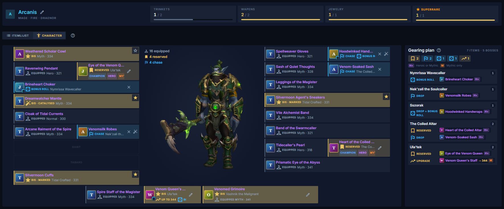

Elk item heeft een gekleurde balk, zodat je meteen ziet wat het is:

| Balk | Betekenis |
| --- | --- |
| Grijs, **Equipped** | Dit draag je nu, met de tier en het item level. |
| Goud, **BiS** (achtergrond) | Dit item is voor jou best in slot. Dat kan zijn omdat je een item uit de lootlijst op het beste item level draagt, omdat je het zelf als BiS hebt gemarkeerd (**BiS · Marked**), of omdat het een gecatalyseerd tier-item is (**BiS · Catalysed**). |
| Goud, **Reserved** | Je hebt dit item gereserveerd, met de tiers waarvoor. Staat er **BiS**, dan heb je het op het beste item level van een drop en is de achtergrond extra goudkleurig. Staat er **Up to 344**, dan kan een bonusrol het item nog verbeteren. |
| Blauw, **Chase** (vlaggetje) | Je wilt dit item van de boss krijgen. Zit het item ook al op BiS-niveau, dan krijgt het de gouden BiS-achtergrond. |
| Blauw, **Bonus roll** (dobbelsteen) | Je wilt dit item met een bonusrol krijgen. De dobbelsteen staat ook op het icoon. |

- **Twee items in één slot**: draag je bijvoorbeeld laarzen en staan er andere laarzen op je chase-lijst, dan staan beide naast elkaar in het slot **Feet**. Het equipped item is grijs, het gechasede blauw. Gereserveerde items hebben een goudkleurige achtergrond, zodat ze opvallen. Staan er drie items in één slot, dan komt de derde op een tweede regel. Past een naam niet, dan wordt hij afgekort met "…".
- **Draag je een item dat je hebt gereserveerd of gechased?** Dan staat het één keer in het slot, met erbij **Equipped** en de tier die je draagt.
- **Indeling en taal**: het overzicht heeft dezelfde indeling als het character-scherm in het spel (met lege plekken voor shirt en tabard), en de teksten in het overzicht zijn Engels, zoals je dat uit het spel kent.
- Klik op het potlood om een reservering aan te passen. Klik op het kruisje om een item van je chase-lijst te halen.
- In het midden staat je character. Heeft Blizzard een publieke armory-afbeelding van je character, dan zie je die. Anders staat er de beginletter van je naam.
- Het overzicht past samen met het Gearing plan op een 1080p-scherm op 100% zoom zonder scrollbalk.

### Gearing plan: wat moet je waar doen?

Rechts naast het character-overzicht staat het **Gearing plan**. Dat zet je open items **per boss** op een rij, in de volgorde waarin je de bosses killt, zodat je weet waar je heen moet en waarvoor:

| Label | Betekenis |
| --- | --- |
| **Reserved** | Je hebt het item gereserveerd: het moet droppen en je lootmeister wijst het toe. |
| **Drop** | Je chaset het item voor een bossdrop. |
| **Bonus roll** | Je wilt het item met een bonusrol krijgen. |
| **Drop + bonus roll** | Je wilt het item, hoe dan ook: een drop of een bonusrol, wat het eerst komt. |
| **Upgrade** (met een pijl, bijvoorbeeld → 344) | Het item is al BiS, maar een bonusrol op deze boss kan het nog verbeteren. |

Achter elk item staat vanaf welke **difficulty** het je helpt:

| Label | Betekenis |
| --- | --- |
| **H+** (paars) | Heroic **of** Mythic helpt. |
| **M** (oranje) | Alleen **Mythic** helpt. |

Dat hangt af van wat je al draagt. Draag je op die plek een Normal- of Heroic-variant, dan helpt een **Heroic-bonusrol** al: daar krijg je een Mythic-variant van (334). Heb je het item al op 341, dan helpt alleen een **Mythic-bonusrol** op Ula'tek of The Coiled Altar (344). Heb je een item **gecatalyst** (het tier-stuk dat je nu draagt is al 334, de Mythic-variant), dan telt dat als wat je ervan hebt: een bonusrol-chase erop laat dan **M** zien, want alleen een Mythic-bonusrol op een van de laatste twee bosses (344) is nog beter. Chaset je een item op **beide** manieren, dan zie je de laagste difficulty waarop het iets oplevert; houd je muis boven het label voor de uitleg per manier. Onderaan het plan staat een kleine legenda.

Een voorbeeld: bij **The Coiled Altar** zie je welke items je daar met een bonusrol wilt halen, en bij **Ula'tek** staat naast je gereserveerde items een **Upgrade** voor je wapen. Bovenaan staan de totalen (het aantal items per soort) en hoeveel bosses je nog moet doen.

- Items die klaar zijn (BiS, zonder upgrade die je nog wilt) staan er niet meer in. Het plan vult zich dus vanzelf bij als je chaset of reserveert, en wordt korter zodra de armory laat zien dat je items hebt.
- Ga met je muis over een item om te zien wat je er nu van draagt.
- Het plan past op een 1080p-scherm naast het overzicht. Is het plan erg lang, dan scrolt het binnen zijn eigen venster. Op een smal scherm staat het onder het overzicht.

### Je gear wordt automatisch bijgewerkt

De app leest je equipped gear uit de Blizzard armory (via de naam en realm van je character). Dat gebeurt:

- elke keer dat je het loot-scherm opent (hoogstens eens per 10 minuten),
- automatisch op de achtergrond voor iedereen (elk half uur),
- of direct, wanneer een officer op **Gear synchroniseren** klikt.

Daarbij gebeurt dit met items die je hebt gereserveerd of gechased:

- Draag je zo'n item op **Hero** of **Myth**, dan telt dat als "al in bezit" voor die tier. Je reservering gaat dan automatisch alleen nog over de **hogere** tiers. Je teamgenoten en officers zien dit ook meteen: je telt niet meer mee voor tiers die je al hebt.
- Draag je een gereserveerd item op **Myth** en kan er niets beters meer van komen? Dan zie je **BiS in bezit! Gefeliciteerd!**. Kan een bonusrol het item nog verbeteren (zie [BiS is niet altijd klaar](#bis-en-upgraden-met-een-bonusrol)), dan zie je **Myth in bezit · tot 344 mogelijk**.
- **Champion** telt niet mee: die items worden toch snel geüpgraded.
- Een **gechased** item is klaar zodra je het hebt op het beste item level van een van de manieren waarop je het chaset (het maakt niet uit hoe het item komt). Bij **Chase voor bossdrop** is dat het maximale item level van een drop (nu 334), bij **Chase met bonusrol** het item level van een bonusrol op die boss (op Coiled Altar en Ula'tek 344). Dan verdwijnt het van je chase-lijst.
- De app maakt nooit zelf nieuwe reserveringen of chases aan, en zet een tier die je zelf hebt aangegeven nooit lager.

**Hoe bepaalt de app of een item Hero of Myth is?** Aan het **item level**, want de tekst die Blizzard bij een item toont ("Heroic") klopt niet altijd met de upgrade-track waar het item nu op zit.

| Item level | Tier |
| --- | --- |
| 322 en hoger (dus ook 334) | **Myth** |
| 321 (Hero 6/6 of Myth 2/6) | **Myth** als Blizzard het item "Mythic" noemt, anders **Hero** |
| Lager dan 321 | **Hero** als het een Heroic-item is, anders niet bijgehouden (zoals Champion) |

Gecrafte items tellen niet mee. De grenzen staan per seizoen in de code (`trackItemLevels`) en kunnen daar worden aangepast.

Als er iets wordt bijgewerkt, zie je bovenin een melding, bijvoorbeeld *"Gear bijgewerkt: Venomed Grimoire (Myth) al in bezit."*

> De armory kan een paar minuten achterlopen op wat je in het spel draagt. Draag je het item net? Even wachten dus. Staat je character op privé, of zijn naam of realm niet ingevuld? Dan kan de app je gear niet lezen. De rest van de app werkt gewoon.

---

## 4. Een item reserveren

1. Zoek het item (tab, zoekbalk, of scroll naar de boss).
2. Klik op **Reserveer**.
3. Er opent een venster **Item reserveren**. Kies de tier vanaf waar je het item wilt hebben:

   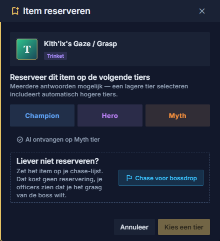

   - **Champion**, **Hero** of **Myth**.
   - Je kunt maar één tier aanklikken. Die tier is je **ondergrens**. **Hogere tiers worden automatisch meegenomen** (gemarkeerd met "auto").
   - Voorbeeld: kies je **Hero**, dan reserveer je voor **Hero + Myth**. Kies je **Champion**, dan reserveer je voor **alle drie** de tiers.
4. Liever niet reserveren? Onderin het venster staat **Liever niet reserveren? Chase voor bossdrop**. Dat zet het item op je chase-lijst zonder dat het een reservering kost.
5. Klik op de knop onderaan, bijvoorbeeld **Reserveer voor Hero + Myth**. De knop zegt **Kies een tier** zolang je nog niets hebt gekozen.

   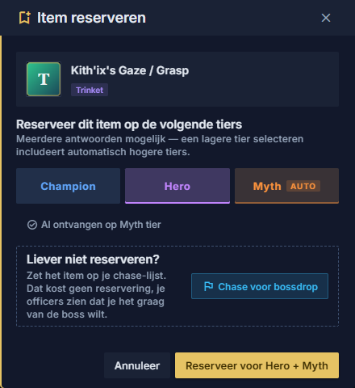

### Heb je het item al?

- **Al een lagere versie** (bijvoorbeeld Champion)? Kies dan de tier erboven (Hero). Zo zeg je: "Champion heb ik al, ik wil nog Hero of Myth."
- **Het item al op Myth-tier?** Klik op **Al ontvangen op Myth tier**. Het item krijgt dan het label *BiS in bezit* en gebruikt één van je plekken.

> Let op: reserveren kost een plek in die categorie. Kies dus bewust. Annuleren kun je niet zelf, zie hieronder.

---

## 5. Een reservering aanpassen of annuleren

### Aanpassen (zelf)

1. Klik bij het item op **Pas aan**, of klik op het item in je **Soft reserves** bovenaan.
2. Kies een andere tier als ondergrens.
3. Klik op **Opslaan voor …**.

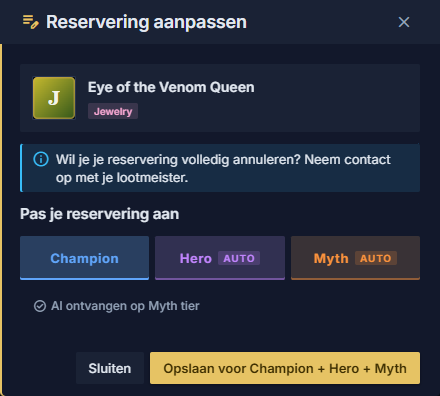

### Annuleren (via je lootmeister)

Een reservering **helemaal verwijderen kun je niet zelf** in de app.

- Wil je een item volledig annuleren, of wil je een ander item reserveren terwijl je limiet bereikt is? **Neem contact op met je lootmeister.**
- Die haalt de reservering weg. Daarna komt er een plek vrij en kun jij het andere item reserveren.

---

## 6. Items op je chase-lijst zetten

Niet alles kun je reserveren. Armor heeft bijvoorbeeld meestal geen reserveer-plekken. Toch wil je misschien graag een nieuw borststuk. Dat kun je laten weten met de **chase-lijst**: een lijst met items die jij graag wilt hebben, **zonder dat je ze reserveert**. Je zegt er ook bij **hoe** je het item hoopt te krijgen. Zo kun je je gearing plannen.

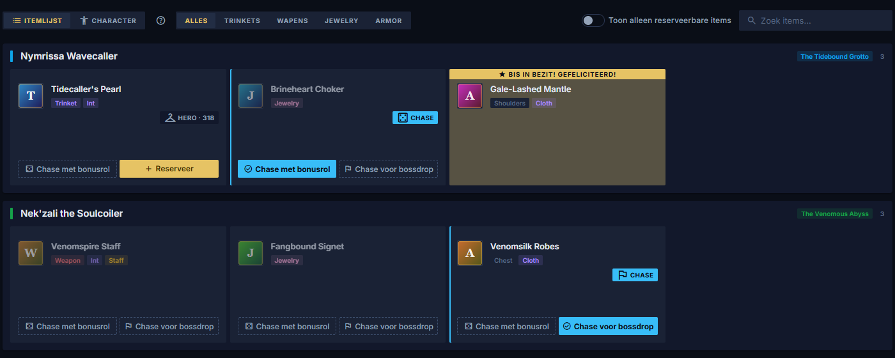

### Twee manieren: bonusrol of bossdrop

In het spel kun je na een kill een **bonusrol** gebruiken: een persoonlijke extra rol die een item uit de loottable van die boss kan geven, op een **hogere difficulty** dan waarop je de boss hebt gedood. Je doodt de boss bijvoorbeeld op Heroic en rolt dan een Myth-item. Daarom zijn er twee knoppen:

| Knop | Betekenis |
| --- | --- |
| **Chase met bonusrol** (dobbelsteen) | Je hoopt dit item met een bonusrol te krijgen. Je officers delen het dan niet uit. |
| **Chase voor bossdrop** (vlaggetje) | Je hoopt dit item als drop van de boss te krijgen. Je officers zien dat je het wilt. |

Je kunt **één van beide** aanzetten, of **allebei**: het maakt niet uit hoe je het item krijgt, als je het maar krijgt. Zet je beide aan, dan verdwijnt de chase zodra je het item hebt, op welke manier dan ook. Zet je de laatste manier uit, dan staat het item niet meer op je chase-lijst. In het [character-overzicht](#twee-weergaven-itemlijst-en-character) krijgen items die je (ook) met een bonusrol wilt krijgen een **dobbelsteen**.

> Of er bonusrollen zijn, hangt van het seizoen af. Heeft je team ze uitgezet in de seizoen-config, dan zie je alleen **Chase voor bossdrop**.

### Chase of reserveer: wat is het verschil?

| | **Reserveren** (goud) | **Chase** (blauw) |
| --- | --- | --- |
| Kost een plek in je limiet | Ja | **Nee** |
| Kies je een tier | Ja | Nee |
| Kun je er zoveel van zetten als je wilt | Nee, maximaal je limiet | **Ja** |
| Zelf weghalen | Nee, via je lootmeister | **Ja, met één klik** |
| Wat het doet | Zo beslist je lootmeister wie het item krijgt | Je officers zien dat je dit item wilt hebben en hoe je het wilt krijgen, zodat ze weten welke bosses nog interessant zijn voor jouw gear |

Een chase is dus **geen reservering**. Je maakt er geen aanspraak mee op een item.

### Een item chasen

1. Zoek het item. Bij items die je niet kunt reserveren staan in plaats van **Reserveer** twee blauwe knoppen.
2. Klik op **Chase met bonusrol** of **Chase voor bossdrop**. De knop wordt **effen blauw met een vinkje** en rechts op de tweede regel van het kaartje verschijnt een blauw **CHASE**-label.
3. Wil je het item eraf halen? Klik nog een keer op de knop met het vinkje.

Zit je al op je limiet in een categorie? Dan is het kaartje gedimd en staat er geen **Reserveer**-knop, maar kun je het item toch chasen met de twee knoppen.

Reserveer je later alsnog een item dat je chaset voor de bossdrop? Dan verdwijnt die chase automatisch en staat het bij je **Soft reserves**. Een **bonusrol-chase** blijft staan: die kun je naast je reservering houden. Je kunt een gereserveerd item dus wel met een bonusrol chasen, maar niet voor de bossdrop (dat is de reservering zelf).

### BiS en upgraden met een bonusrol

Een item is **BiS in bezit** zodra je het hebt op het **beste item level van een drop**: nu 334 (trinkets en wapens kunnen via een upgrade naar 341). Dat geldt voor alle bosses. Maar een **bonusrol** op **The Coiled Altar** en **Ula'tek** geeft **344**. Zo'n item is dus al BiS op 334, en een bonusrol kan het nog **upgraden**.

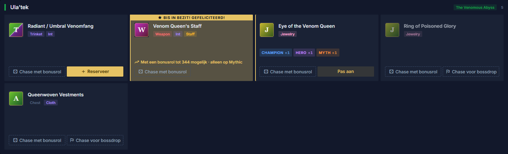

- Bij zo'n item zie je naast **BiS in bezit** de melding **Met een bonusrol tot 344 mogelijk** en de knop **Chase met bonusrol**. Klik daarop om die upgrade te plannen.
- In het [character-overzicht](#twee-weergaven-itemlijst-en-character) krijgt het item een dobbelsteen en staat er **Up to 344**.
- Dit werkt ook voor een item dat je hebt gereserveerd. Een bossdrop kan hier niet bij: een drop geeft geen 344.
- Zodra de armory laat zien dat je het item op 344 draagt, verdwijnt de chase vanzelf.
- Weet de app je item level niet (bijvoorbeeld omdat je zelf "Al ontvangen op Myth tier" hebt gekozen), dan nemen we aan dat het een gewone drop van 334 is.

### Zelf aangeven dat iets BiS is

Niet elk BiS-item komt uit de raid: gecrafte laarzen en handschoenen die je niet gaat vervangen, of een item uit een dungeon dat niet in de lootlijst staat maar wel BiS is voor jouw spec. Dat geef je zelf aan in het [character-overzicht](#twee-weergaven-itemlijst-en-character):

1. Ga met je muis over een item dat je **equipped** hebt. Rechtsboven verschijnt een **sterretje**.
2. Klik erop. Het item krijgt de gouden BiS-achtergrond en het label **BiS · Marked**.
3. Klik nog een keer op het sterretje om de markering weg te halen.

De markering geldt zolang je **dat item** in **dat slot** draagt. Trek je er een ander item aan, dan verdwijnt de markering vanzelf. Het is alleen voor je eigen overzicht en verandert niets aan je reserveringen of chases.

Een item uit de lootlijst dat je op het beste item level draagt (en dus precies het item is dat je wilde), krijgt de BiS-achtergrond vanzelf. Het maakt daarbij niet uit of het nog op je chase-lijst stond.

### Catalyst: een chase omzetten in een tier-item

Bij de **catalyst** zet je een item met goede stats om in het tier-item van dat slot (dat de set-bonus geeft). Je chaste bijvoorbeeld een bepaalde schouderset en hebt die gecatalyseerd. Het tier-item dat je nu draagt is een **ander item**, dus de app ziet niet vanzelf dat je je chase-item hebt.

1. Zorg dat het tier-item dat je nu draagt in je gear staat (laat zo nodig de gear synchroniseren).
2. Zoek in het [character-overzicht](#twee-weergaven-itemlijst-en-character) je chase-item. Bij items in een tier-slot (hoofd, schouders, borst, handen of benen) staat naast het kruisje een **toverstafje** (**Catalysed into my tier piece**).
3. Klik erop. Het tier-item dat je in dat slot draagt wordt BiS (**BiS · Catalysed**) en je chase verdwijnt.

Het item dat je hebt gecatalyseerd is daarmee **op**: je hebt het niet meer, alleen het tier-item. Chase je daarna hetzelfde item opnieuw (bijvoorbeeld met een bonusrol, voor een versie van 344 die je weer catalyseert), dan is dat een gewone chase zonder BiS-achtergrond. Een chase-item krijgt pas de gouden BiS-achtergrond als je **precies dat item** draagt op het beste item level.

### Je chase-lijst als character-overzicht

Wil je in één oogopslag zien wat je al hebt gereserveerd of gechased, en waar je nog gaten hebt? Kies links in de filterbalk voor **Character**. Zie [Twee weergaven](#twee-weergaven-itemlijst-en-character).

### Alleen reserveerbare items zien

Wil je alleen de items zien die je echt kunt reserveren? Zet rechts boven de lijst **Toon alleen reserveerbare items** aan. De items zonder reserveer-mogelijkheid (zoals armor) en de tab **Armor** verdwijnen dan uit beeld.

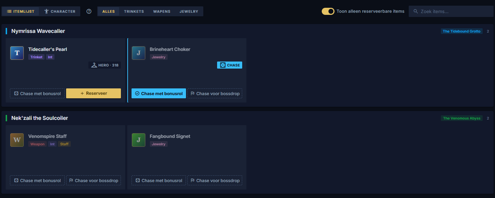

### Voor officers en lootmeesters

Bij **Loot toewijzen** staat in de balk bovenaan de schakelaar **Toon ook chase-items**.

- **Uit** (standaard): je ziet alleen de gereserveerde items, zoals je gewend bent.

  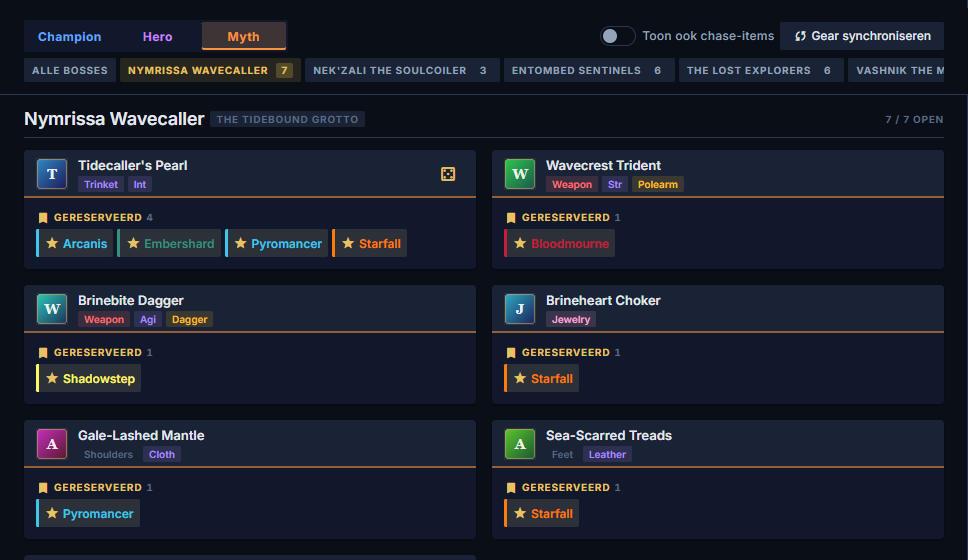

- **Aan**: onder elke gereserveerde groep komt een blauwe groep **Chase-lijst** (vlaggetje) met raiders die het item van de boss willen, en een groep **Bonusrol** (dobbelsteen) met raiders die het met een bonusrol willen krijgen. Zit een item alleen op een chase-lijst en heeft niemand het gereserveerd, dan verschijnt het item ook in de lijst. Zo zie je welke bosses nog gecleared moeten worden voor de gear-upgrades van je team.

  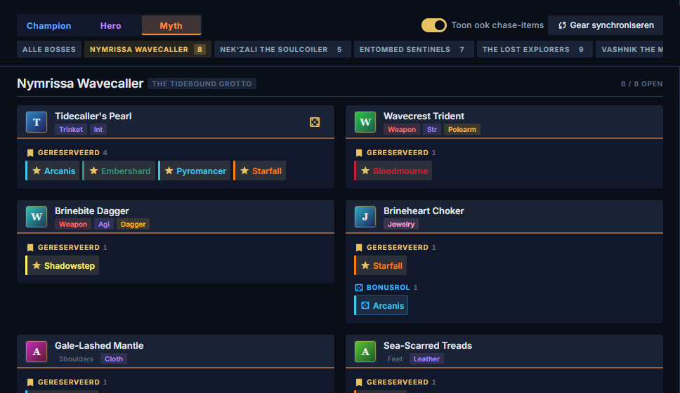

Rechts in de balk staat ook **Gear synchroniseren**. Die leest de equipped gear van het hele team opnieuw uit de Blizzard armory en vinkt gereserveerde en gechasede items af die al equipped zijn (zie [Je gear wordt automatisch bijgewerkt](#je-gear-wordt-automatisch-bijgewerkt)). Dat gebeurt ook elk half uur vanzelf. Wie een item al op de gekozen tier draagt, staat daarom niet meer bij dat item.

Een raider op de chase-lijst kun je net als anderen aanklikken om het item toe te wijzen. Raiders in de groep **Bonusrol** niet: die willen het item met een bonusrol krijgen, dus je deelt het niet uit. Chasers doen ook **niet** mee met de Wheel of Fortune: alleen raiders die het item hebben gereserveerd rollen mee.

### Seizoen-config: gear-tiers en bonusrol

Volgend seizoen zijn de item levels weer anders. Daarom staat bij **Seizoen config** (per team) een blok **Gear-tiers en bonusrol** met een stuk **Beste item level**:

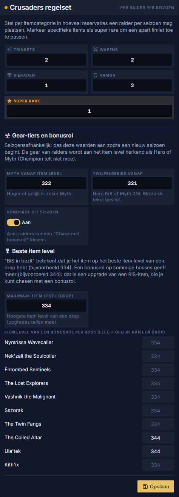

- **Myth vanaf item level**: gear op dit level of hoger is zeker Myth (nu 322, dus 334 is Myth).
- **Twijfelgebied vanaf**: Hero 6/6 en Myth 2/6 hebben hetzelfde item level (nu 321). Daar beslist de tekst van Blizzard. Daaronder telt alleen een Heroic-item als Hero. Champion telt niet mee.
- **Bonusrol dit seizoen**: zet dit uit als er dit seizoen geen bonusrollen zijn. Dan verdwijnt **Chase met bonusrol**.
- **Maximaal item level (drop)**: het hoogste item level van een drop, inclusief upgrades (nu 334). Op dit level of hoger is een item **BiS**. Een bonusrol die meer geeft is een extra upgrade.
- **Item level van een bonusrol per boss**: vul in op welke bosses een bonusrol meer geeft dan een drop (nu 344 bij **The Coiled Altar** en **Ula'tek**). Laat je het leeg, dan geeft een bonusrol op die boss niet meer dan een drop. Zo'n boss krijgt geen upgrade-chase. Zet je **Bonusrol dit seizoen** uit, dan tellen deze waarden niet mee.

Laat je een waarde leeg, dan geldt de standaardwaarde van het seizoen. Pas deze waarden aan zodra bekend is hoe het nieuwe seizoen werkt. De gear van raiders wordt bij de eerstvolgende synchronisatie opnieuw beoordeeld.

---

## 7. Zien wie er nog meer op een item zit

Bij een item dat je hebt gereserveerd, zie je kleine tier-labels (Champion / Hero / Myth). Staat er een getal bij, bijvoorbeeld **+2**, dan hebben **2 andere raiders in jouw team** hetzelfde item voor die tier gereserveerd.

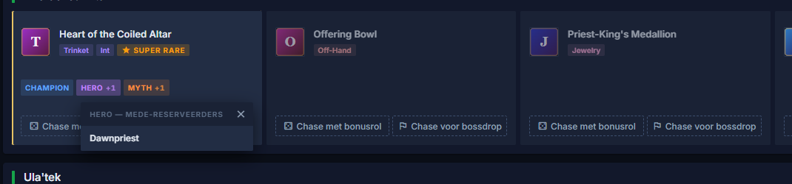

- Klik op een tier-label om de **namen** van die raiders te zien.
- Je ziet alleen raiders uit je eigen team.
- Een raider die de tier al heeft ontvangen, telt niet meer mee voor die tier.

---

## 8. Je character of team wijzigen

### Naam, realm, spec of team aanpassen

1. Klik op het **potlood-icoontje** naast je characternaam op het loot-scherm.
2. Pas je gegevens aan en sla op.

### Na het koppelen van Battle.net

Heb je je character eerst handmatig ingevuld en koppel je later Battle.net (knop **Link BNET** rechtsboven)? Dan kun je een character kiezen om je naam en realm bij te werken. Dit werkt alleen voor een character **met dezelfde class**.

### Van class of spec veranderen

Wil je naar een andere class? Neem dan **eerst contact op met Bram | Sapphire**. Via de Battle.net-koppeling kun je alleen een character met dezelfde class kiezen.

> Wissel je van spec of team, dan kan je lijst met beschikbare items veranderen. Controleer daarna je reserveringen.

---

## 9. Wheel of Fortune (rolls bekijken)

Gaan er meerdere raiders om één item rollen, dan kan een officer een **Wheel of Fortune** starten. De officer deelt een link in Discord.

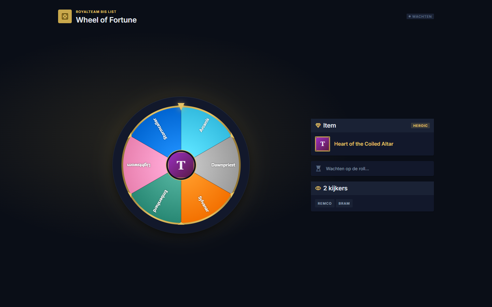

- Open de link om **live mee te kijken**. Inloggen is niet nodig.
- Je ziet het item, de deelnemers, de draaiende wheel en de **winnaar**.
- Staat er **Sessie niet gevonden of verlopen**, dan is de roll al afgelopen of is de link niet meer geldig. Vraag een officer om een nieuwe link.

---

## Veelgestelde vragen en troubleshooting

### Inloggen en account

**Ik zie "Inloggen met Google" maar na het inloggen gebeurt er niets, of ik kom weer op het loginscherm.**
- Zorg dat je browser cookies en site-opslag toestaat. Privé-/incognitovensters en strikte tracking-blokkers kunnen het inloggen verstoren.
- Probeer een normaal browservenster en probeer het opnieuw.
- Lukt het nog niet, wis dan de sitegegevens voor lootlijst.royal-team.nl en log opnieuw in.

**Ik word steeds uitgelogd.**
Dat hoort zelden te gebeuren. Je sessie wordt automatisch verlengd. Doet het toch, dan blokkeert je browser waarschijnlijk opslag. Zie het antwoord hierboven.

**Mijn reserveringen zijn weg!**
Je bent waarschijnlijk met een **ander Google-account** ingelogd. Log uit en log in met het account dat je de eerste keer gebruikte.

**Ik zie "Geen toegang — Je hebt geen rechten voor deze pagina."**
Je probeert een pagina te openen die alleen voor officers is (bijvoorbeeld het Admin-paneel). Klik op **Terug naar Home**. Je hebt als raider alleen **Mijn Loot** nodig.

**Ik zie "Wij zijn verhuisd!"**
Je gebruikt een oud adres. Ga naar **https://lootlijst.royal-team.nl**.

### Character en Battle.net

**Ik zie mijn characters niet na het koppelen van Battle.net.**
- Je ziet alleen characters van **level 10 of hoger**.
- Heb je een tijdje niet ingelogd bij Blizzard, dan kan de koppeling verlopen zijn. Klik opnieuw op **Link BNET** en geef toestemming.
- Blijft het mislukken? Klik op **Handmatig invullen** en vul je character zelf in.

**Ik zie "Karakters ophalen mislukt. Vul handmatig in."**
De app kon Battle.net niet bereiken. Klik op **Handmatig invullen**, of probeer het later opnieuw.

**Ik zie "Geen Battle.net account gekoppeld" of "Battle.net token verlopen. Koppel opnieuw."**
Klik rechtsboven op **Link BNET** en doorloop de koppeling opnieuw. Je gewone login (Google) blijft gewoon werken.

**Ik zie de melding "Als je je class en spec wilt veranderen neem eerst contact op met Bram | Sapphire".**
Je koos bij het bijwerken van je character een character met een **andere class** dan je profiel. Vraag Bram om je class en spec te laten wijzigen.

**Ik heb een typfout in mijn naam of realm gemaakt.**
Klik op het potlood-icoontje naast je naam op het loot-scherm en pas het aan.

### Items zoeken en reserveren

**Ik zie een item niet dat ik wel wil hebben.**
Dat kan meerdere oorzaken hebben:
- Het item past niet bij je **class of spec**. Het kan bijvoorbeeld de verkeerde armor type, primary stat of wapentype hebben, of het is een class-specifiek tier-token.
- Je **spec** in je profiel klopt niet. Controleer die via het potlood-icoontje.
- **Toon alleen reserveerbare items** staat aan. Zet de schakelaar uit om ook de items te zien die je niet kunt reserveren (zoals armor).
- Er staat nog een **filter of zoekopdracht** aan. Klik op **Filters wissen**.

**Ik zie "Geen items gevonden".**
Staat er *"Er zijn geen items die bij je filter passen"*, klik dan op **Filters wissen**. Staat er *"Maak eerst een character aan"*, dan heb je nog geen profiel. Staat er *"Geen reserveerbare items voor jouw class en spec"*, controleer dan je class en spec.

**Een item is gedimd en heeft geen Reserveer-knop.**
Je hebt in die categorie al het maximum aantal reserveringen. Wil je dit item liever? Vraag je lootmeister om een andere reservering in die categorie te annuleren (zie [Annuleren](#annuleren-via-je-lootmeister)). Wil je alleen laten weten dat je het item graag wilt hebben? Chase het dan, zie [hoofdstuk 6](#6-items-op-je-chase-lijst-zetten).

**Mijn equipped gear staat er niet, of is verouderd.**
De app leest je gear uit de Blizzard armory. Dat lukt alleen als je naam en realm kloppen en je character niet op privé staat. Controleer die via het potlood-icoontje op het loot-scherm. Blizzard werkt de armory pas bij als je uitlogt in het spel, dus een net aangetrokken item kan er nog even over doen. Je kunt een officer vragen om **Gear synchroniseren** te gebruiken.

**Een item staat als Hero, maar in het spel is het Myth (of andersom).**
De app bepaalt de tier aan de hand van het item level (zie hierboven). Zit er een item tussen, bijvoorbeeld op level 321, dan kan het fout staan. Meld het met de feedbackknop, met de naam van het item en het level.

**Ik heb een chase-item gecatalyseerd en de app weet het niet.**
Gebruik in het character-overzicht het toverstafje bij je chase-item (zie [Catalyst](#catalyst-een-chase-omzetten-in-een-tier-item)). Het tier-item moet dan wel in je gear staan.

**Mijn gecrafte of dungeon-items zijn BiS, maar staan niet als BiS.**
Markeer ze zelf met het sterretje in het character-overzicht (zie [Zelf aangeven dat iets BiS is](#zelf-aangeven-dat-iets-bis-is)).

**Mijn reservering of chase is ineens "al in bezit" of weg.**
Dat komt door de automatische gear-controle: je draagt het item (op Hero of Myth). Een gereserveerd item blijft gereserveerd voor de hogere tiers. Een gechased item dat je op Myth draagt, haalt de app van je chase-lijst. Klopt het niet? Meld het met de feedbackknop.

**Ik zie geen plaatje van mijn character in het character-overzicht.**
Dat is normaal als Blizzard geen publieke armory-afbeelding van je character heeft. Dat gebeurt bijvoorbeeld als je je character handmatig zonder realm hebt ingevuld, als de naam of realm niet klopt, of als je al lang niet bent ingelogd in het spel. Controleer je naam en realm via het potlood-icoontje op het loot-scherm. Zonder plaatje werkt het overzicht gewoon.

**Er staan "Chase met bonusrol" en "Chase voor bossdrop" in plaats van "Reserveer".**
Je kunt dit item dit seizoen niet reserveren, bijvoorbeeld omdat je team geen armor laat reserveren. Je kunt het wel op je chase-lijst zetten. Dat is geen reservering. Zie [hoofdstuk 6](#6-items-op-je-chase-lijst-zetten).

**Telt een item op mijn chase-lijst mee voor mijn limiet?**
Nee. Je chase-lijst heeft geen limiet en kost geen reserveer-plek. Een item op je chase-lijst geeft je ook geen voorrang bij het uitdelen. Je officers gebruiken de lijst alleen als overzicht.

**Ik heb per ongeluk een item op mijn chase-lijst gezet.**
Klik nog een keer op de knop met het vinkje bij dat item. Het verdwijnt direct van je lijst. Dat kun je zelf doen.

**Ik krijg een foutmelding bij het reserveren.**
De app toont de reden in een melding onderaan het scherm. De meest voorkomende:

| Melding | Wat het betekent |
| --- | --- |
| *You can reserve at most N … per season.* | Je limiet in die categorie is bereikt. |
| *You can reserve at most N superrare item(s) per season.* | Je Superrare-limiet is bereikt. |
| *This item type cannot be reserved this season.* | Deze categorie staat dit seizoen uit voor jouw team. |
| *You already reserved this item for this season.* | Je had dit item al gereserveerd. Vernieuw de pagina. |
| *Raider profile not found…* | Je hebt nog geen character. Maak die eerst aan. |

Zie je iets anders, vernieuw dan de pagina en probeer het opnieuw. Werkt het dan nog niet, gebruik dan de feedbackknop (zie hieronder).

**Wat is "Super rare"?**

Items met een ⭐ zijn door de officers aangemerkt als bijzonder gewild of zeldzaam. Daarvoor geldt een **eigen limiet** (de tegel **Superrare**). Een super-rare item telt mee voor die limiet. Is die limiet **0**, dan is er geen aparte plek voor.

**Wat betekent "Champion + Hero + Myth" precies?**
Dat zijn de drie tiers (versies) van hetzelfde item. Je kiest de **laagste tier** die je nog wilt hebben. Alle hogere tiers doen automatisch mee. Zo kun je bijvoorbeeld zeggen dat je Champion al hebt en alleen nog Hero of Myth wilt.

**Ik heb een item per ongeluk op de verkeerde tier gereserveerd.**
Klik op **Pas aan** en kies de juiste ondergrens. Dat kun je zelf doen.

**Ik heb per ongeluk het verkeerde item gereserveerd.**
Vraag je lootmeister om de reservering te annuleren. Reserveer daarna het goede item.

**Twee items hebben één icoon, zijn dat er twee?**
Samengevoegde items (twee icoontjes in één) tellen als **één reservering**.

**Wat gebeurt er als ik een item ontvang?**
De lootmeister markeert dat in het systeem. Heb je een item op Myth-tier gekregen, dan zie je **BiS in bezit! Gefeliciteerd!**.

### Scherm en technische problemen

**De pagina laadt niet, of blijft op "Catalogus laden…".**
1. Ververs de pagina (F5, op een telefoon trek je omlaag).
2. Controleer je internetverbinding.
3. Probeer een ander apparaat of een andere browser.
4. Blijft het probleem bestaan? Meld het met de feedbackknop of aan een officer.

**De site toont nog oude gegevens of mist een nieuwe functie.**
Sluit de tab en open de site opnieuw. Werkt de site als app, sluit hem dan helemaal af en open hem opnieuw.

**Ik kan niet vinden hoe ik uitlog op mijn telefoon.**
Tik rechtsboven op het menu (drie streepjes). Onderaan staat **Uitloggen**.

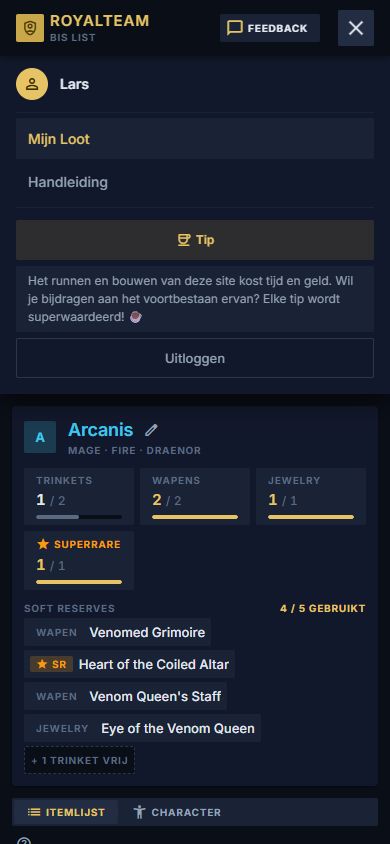

**Mijn teamgenoot ziet andere items of limieten dan ik.**
Dat kan kloppen. Items en limieten hangen af van **team, class en spec**.

### Contact en feedback

**Hoe meld ik een bug of idee?**
Gebruik de **feedbackknop** rechtsonder in beeld. Beschrijf wat je deed en wat er gebeurde. Een melding mét de tekst van een foutmelding helpt het meest.

**Wie moet ik bij een vraag over loot of reserveringen hebben?**
Je **lootmeister** (annuleren, limieten, vragen over verdeling) of je **raidleader**. Voor het wijzigen van je class of spec ga je naar **Bram | Sapphire**.

**Wat doet de "Tip"-knop?**
Het runnen en bouwen van deze site kost tijd en geld. Met een tip steun je het voortbestaan van de site. Dat is helemaal vrijwillig.
